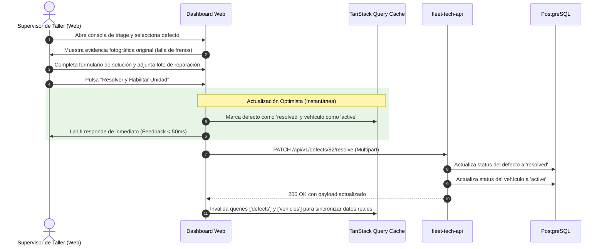

# 🏛️ Arquitectura Detallada de Fleet Tech Web

Documento de especificación arquitectónica para el panel de control web de **Fleet Tech**, enfocado en renderizado concurrente, virtualización de alta densidad, interacción en tiempo real y comunicación resiliente con `fleet-tech-api`.

---

## 📐 1. Diagrama de Capas y Ciclo de Vida de Peticiones

```mermaid
flowchart TD
    subgraph UI_Layer ["Capa de Presentación (React 19 + Tailwind)"]
        Components[Componentes Feature & Vistas]
        Virtualizer[TanStack Virtual / TanStack Table]
        Components -->|Renderiza dentro de Viewport| Virtualizer
    end

    subgraph State_Management ["Capa de Gestión de Estado"]
        ZustandStore[Zustand Store\n(Filtros de Patio, Modales, Preferencias UI)]
        QueryCache[TanStack Query Cache\n(Vehículos, Defectos, Inspecciones, Plantillas)]
        Components -->|Accede y muta| ZustandStore
        Components -->|Suscribe con useQuery / useMutation| QueryCache
    end

    subgraph Service_Infrastructure ["Capa de Infraestructura y Red"]
        ApiService[Typed API Clients]
        AxiosInstance[Axios con Interceptors de Auth y Retry]
        QueryCache -->|Dispara Fetch / Mutate| ApiService
        ApiService --> AxiosInstance
    end

    subgraph Backend_API ["Backend (fleet-tech-api)"]
        AxiosInstance -->|HTTPS REST Bearer Token| LaravelApi[Endpoints /api/v1/*]
    end
```

---

## ⚡ 2. Arquitectura de Virtualización de Tablas

Para garantizar fluidez absoluta durante el desplazamiento vertical en listados con miles de inspecciones y vehículos:

```mermaid
flowchart LR
    Dataset[Dataset en Memoria (ej: 5,000 vehículos)] --> VirtualizerHook[useVirtualizer Hook]
    VirtualizerHook --> WindowCalc[Cálculo de Índices Visibles en Viewport]
    WindowCalc --> DomNodes[Renderizado de solo ~25 nodos DOM]
    DomNodes --> Screen[Pantalla sin Caída de Frames (INP < 50ms)]
```

### Principios de Aislamiento Gráfico:
1. **Transformaciones Aceleradas por Hardware:** El posicionamiento de cada fila virtual se realiza mediante `transform: translateY(px)`, evitando tocar `top` o provocar reflujos de geometría en el navegador.
2. **Contención CSS Estricta:** El contenedor de scroll implementa `contain: strict;` y `overflow-anchor: none;` para aislar totalmente su árbol de renderizado del documento principal.

---

## 🔄 3. Ciclo de Triage de Defectos y Desbloqueo Vehicular



---

## 🛡️ 4. Seguridad, Tokens y Manejo de Sesiones

1. **Almacenamiento Seguro de Sesión:**
   - El token Sanctum se gestiona en memoria o en almacenamiento seguro con expiración configurada.
   - En caso de recibir un error HTTP `401 Unauthorized`, el interceptor de Axios purga automáticamente las credenciales y redirige a la pantalla de autenticación.
2. **Defensa contra Fallas de Red:**
   - En caso de errores `502` / `503` o pérdida de conexión momentánea, TanStack Query realiza hasta 2 reintentos con retraso exponencial antes de notificar al usuario mediante un componente *Toast* no intrusivo.
