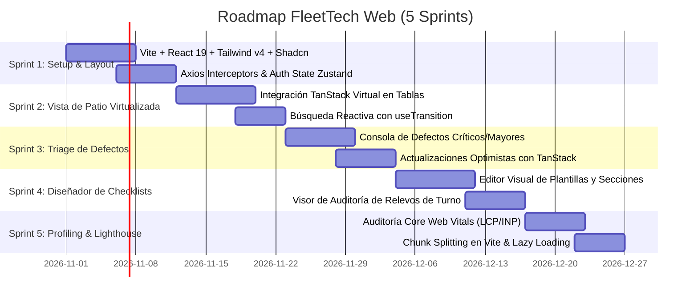

# 💻 Roadmap de Desarrollo - Fleet Tech Web (Dashboard)

Planificación de sprints y desarrollo técnico para el panel de administración web con React 19, Vite, TanStack Query y virtualización de datos.

---

## 📅 Sprints de Desarrollo

---

## 🎯 Detalle por Sprint

### Sprint 1: Setup, Layout y Autenticación
- Configuración de React 19 + TypeScript 5.5 + Vite.
- Sistema de diseño con Tailwind CSS y componentes primitivos Radix UI / Shadcn.
- Cliente Axios con manejo de Bearer Token y redirección ante código `401`.

### Sprint 2: Matriz de Patio y Virtualización de Vehículos
- Tabla de vehículos con `@tanstack/react-virtual` para soportar más de 2,000 unidades en pantalla sin caídas de FPS.
- Barra de búsqueda con *debounce* de 300ms y `useTransition` para evitar retraso al teclear (**INP < 50ms**).
- Aislamiento CSS con `contain: layout paint;` y `content-visibility: auto;`.

### Sprint 3: Consola de Triage y Desbloqueo Vehicular
- Panel de control de defectos filtrados por severidad (`critical`, `major`, `minor`).
- Modal para registrar notas de solución y adjuntar fotos de reparación.
- Actualización optimista: la interfaz marca el defecto como resuelto y habilita la unidad en milisegundos sin esperar al servidor.

### Sprint 4: Diseñador de Checklists y Auditoría
- Constructor de plantillas dinámicas (ordenar secciones, definir obligatoriedad y tipos de input).
- Pantalla de auditoría de relevos con visor comparativo de firmas digitales del operador saliente y entrante.

### Sprint 5: Optimización de Bundles y Core Web Vitals
- División de chunks en Vite (`vendor-react`, `vendor-tanstack`, `vendor-ui`).
- Verificación con Lighthouse CI: **LCP < 1.2s**, **INP < 50ms**, **CLS = 0.00**.
